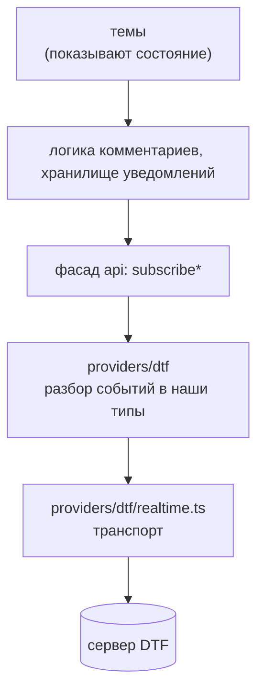

# Живые обновления

DTF рассылает изменения по WebSocket. Приложение подписывается на них и меняет интерфейс без перезагрузки: у открытого поста появляются новые и исправленные комментарии, меняются оценки, у колокольчика растёт число новых уведомлений. Всё это только для DTF: у подключаемых источников сокета нет.

Сокет ничего не заменяет, а ускоряет. Данные по-прежнему загружаются обычными запросами, а события применяются поверх них. Если сокет недоступен, приложение работает как раньше, просто обновляется при следующем запросе.

## Слои

1. **Транспорт** (`providers/dtf/realtime.ts`) знает про соединение и каналы. Что внутри событий, ему безразлично.
2. **Провайдер** разбирает сырые события в наши типы (`RealtimeCommentEvent`, `RealtimeNotificationEvent`) и отбрасывает всё лишнее. Ответы сервера в логику не попадают, как и в остальных частях API (см. [api.md](api.md)).
3. **Фасад** отдаёт подписки методами `api.subscribe*`. Подписка возвращает функцию отписки.
4. **Логика** (комментарии поста, хранилище уведомлений) применяет события к своему состоянию.
5. **Темы** ничего не знают про сокет: они рисуют то, что лежит в состоянии.

Правило: UI подписывается только через фасад. Компоненты и темы не импортируют транспорт и провайдер и не открывают свои сокеты.

## Соединение

- **Одно соединение на приложение.** Все подписки используют общий сокет. Каждый канал подписывается на сервере один раз, сколько бы потребителей на него ни смотрело; потребителей считает транспорт.
- **Протокол.** Свой минимальный клиент старой версии Socket.IO без зависимости: причины в [ADR 0016](../../decisions/0016-realtime-socket-and-counters.md). Токен для подключения не нужен: личные каналы называются по хешу пользователя, который отдаёт профиль.
- **Живость.** Клиент сам шлёт ping и ждёт ответа; нет ответа или рукопожатия вовремя — соединение считается потерянным.
- **Переподключение.** Задержка нарастает с каждой неудачной попыткой, до потолка, с разбросом. Удачное подключение сбрасывает счётчик попыток. После подключения транспорт заново подписывается на все активные каналы и сообщает потребителям, что это повторное подключение: за время обрыва события потеряны, и потребитель должен перечитать данные.
- **Фон и офлайн.** Пока вкладка скрыта или нет сети, таймеры переподключения не крутятся. Соединение восстанавливается сразу, когда вкладка снова видна или сеть вернулась. После пробуждения живой сокет проверяется быстрым ping, не дожидаясь обычного интервала.
- **Отложенное закрытие.** Когда исчезает последний потребитель, сервер узнаёт об отписке сразу, а сокет закрывается не сразу: при переходе между постами старый экран отписывается раньше, чем новый подпишется, и без паузы соединение рвалось бы на каждом переходе. Новая подписка в это время отменяет закрытие. Уже потерянное соединение не держится.
- **События старого сокета** отбрасываются: у каждого соединения своё поколение, и опоздавшие сообщения и таймеры предыдущего ничего не меняют.

## Комментарии

Для поста подписываются на два канала: структура комментариев (создан, изменён, сумма донатов) и оценки. Сервер шлёт в канал оценок и дубли создания и правки в старом формате, их транспорт игнорирует. События удаления и закрепления сервер не присылает: такие изменения подтянет досинхронизация.

Подписку открывает логика комментариев (`components/Comments`) вместе с загрузкой списка, а не тема.

### Слияние

Комментарий из события, свой ответ после отправки и комментарий из досинхронизации проходят через один путь вставки и обновления.

- **Версия.** Если у входящего и у текущего комментария есть дата последнего изменения и входящая старше, он игнорируется. Иначе применяется. Так опоздавшее событие или отстающий ответ REST не откатывают правку.
- **Ничего не изменилось** (типичный случай досинхронизации) — ни обновления узла, ни записи в кэш, ни перерисовки строки.
- **Подмены и восстановленные.** Комментарии из сторонних источников и восстановленные из архива сохраняются: событие DTF не затирает их текст.
- **Свои комментарии и эхо.** Сервер присылает событие и на свой собственный комментарий. Ключи уже виденных комментариев запоминаются, поэтому свой комментарий и его эхо не считаются дважды ни в списке, ни в счётчике.
- **Ответ без родителя.** Если родитель ещё не загружен (приехал событием раньше, чем страница), ответ ждёт его среди «сирот». Когда родитель появился, ответы встают на место. Если страниц больше нет, а родителя всё нет, запрашивается досинхронизация.
- **Счётчик комментариев поста.** Его меняют только живые события и собственная отправка. Вставки из досинхронизации счётчик не трогают: свежий пост уже пришёл с верным числом, а после переподключения число обновляет вызывающий код.

### Досинхронизация

Это фоновая перезагрузка списка, которая добирает то, что мимо сокета: пропущенное за время обрыва, удаления, закрепления, комментарии «сирот». Она запускается:

- после повторного подключения сокета;
- после мгновенного показа списка из кэша (открытие поста, который уже смотрели);
- когда для «сироты» не нашёлся родитель.

**Почему с задержкой.** REST отстаёт от сокета: сразу после события запрос комментариев ещё отдаёт старые данные и догоняет через секунды. Досинхронизация, запущенная сразу, затёрла бы свежие счётчики старыми. Поэтому она ждёт; исключение — показ кэша, там событий ещё не было. Для надёжности счётчики реакций у комментария, по которому голос пришёл из сокета недавно, она не трогает.

Одновременно идёт одна досинхронизация. Если просьба пришла во время загрузки, она ставится в очередь и выполняется, когда загрузка закончится.

Входящие из досинхронизации приходят от авторизованного запроса, поэтому своя реакция берётся из них; для событий сокета своя реакция остаётся из текущего состояния.

## Реакции

Событие голоса содержит прежнюю и новую реакцию комментария, счётчик и id голосующего. Счётчики применяются по правилам:

- **Поставили** (не было → B): счётчик B берётся из события.
- **Сняли** (A → нет): счётчик A берётся из события.
- **Сменили** (A → B): сервер присылает счётчик B без только что поставленного голоса, поэтому к нему добавляется единица, а у A единица вычитается. Оригинальный клиент здесь ошибается на единицу, наше решение осознанно отличается, см. [ADR 0016](../../decisions/0016-realtime-socket-and-counters.md).
- Счётчик, упавший до нуля, убирается из списка.

**Своё действие приходит эхом.** Событие несёт id голосующего, по нему свой голос отличается от чужого. Свой голос уже применён оптимистично при нажатии, поэтому эхо не должно вычесть A второй раз: вычитание делается, только если локально всё ещё стоит A (значит, голос пришёл с другой вкладки или устройства). Из своего события берётся и «своя реакция»; из чужого она остаётся прежней.

**Откат.** Если запрос реакции не удался, откат считается от текущего состояния комментария, а не от снимка, сделанного при нажатии: за время запроса могли прийти чужие голоса, и откатывать надо только свой. Для этого обновление строки принимает не только готовый патч, но и функцию от текущего состояния.

Общий счётчик в событии ненадёжен, его не используют.

## Уведомления

Число на колокольчике ведёт сервер, клиент его только показывает (так же, как у оригинального DTF, см. [ADR 0016](../../decisions/0016-realtime-socket-and-counters.md)).

Откуда берётся число:

- отдельный запрос счётчика при подключении и после повторного подключения сокета;
- событие личного канала: оно несёт полное новое число и само уведомление;
- после успешной загрузки списка число становится нулём: сервер обнуляет свой счётчик при выдаче списка;
- между вкладками и окном PWA в одном браузере загрузка списка и пометка «прочитано» передаются через `BroadcastChannel` (с проверкой пользователя), поэтому счётчик, бейдж/иконка и статусы прочтения обновляются сразу во всех открытых экземплярах.

События и список согласуются так: событие сокета помечает список устаревшим и, если список открыт, перезагружает его; открытие списка загружает его, если он не загружен или устарел. Запрос счётчика, опоздавший к более свежему числу (событие или обнуление после загрузки), его не затирает.

**«Прочитано» — только действие пользователя.** Открытие списка не помечает уведомления прочитанными на сервере: подсветка снимается кликом по уведомлению или кнопкой «Пометить все». Пометка меняет статус в списке сразу и уходит на сервер следом; при ошибке подсветка возвращается. Арифметики со счётчиком нет: число приходит от сервера.

Личный канал называется по хешу пользователя из его профиля. Если сервер хеш не отдал, подписка тихо не создаётся. При сетевой ошибке запроса профиля подписка повторяется с нарастающей задержкой, пока её не отменят.

## Смена сессии

Подписки и состояние привязаны к сессии. При выходе или смене пользователя корневой layout очищает хранилище уведомлений, и оно закрывает свою подписку; при входе подключает заново. Ответ, который ждали при прошлой сессии, не применяется. Подписки комментариев принадлежат открытому посту и закрываются вместе с ним.

## Как добавить канал или событие

Новое событие в существующем канале:

1. Опишите событие типом в `api/types.ts` и добавьте его в объединение, которое принимает подписка.
2. Научите разбор в провайдере его распознавать. Разбор строгий: неизвестная форма даёт `null` и отбрасывается. Если форма известна не из живых наблюдений, а, например, из бандла оригинала, напишите это в комментарии.
3. Примените событие в логике, которая подписана (комментарии, уведомления). Применение идемпотентно: событие могло уже отразиться локально или прийти повторно.
4. Тест на разбор и тест на применение.

Новый канал:

1. В провайдере DTF добавьте подписку, которая вызывает подписку транспорта на канал и преобразует события в наши типы.
2. Пробросьте её через фасад `api.subscribe*` и интерфейс провайдера. Для источника, у которого сокета нет, метод не определяется.
3. Решите, что делает потребитель при повторном подключении: потерянные за обрыв события обычно надо перечитать запросом.
4. Подписывайтесь из логики, а не из компонента темы, и обязательно отписывайтесь в очистке эффекта.

Протокол менять не нужно: транспорт универсален. Если сервер ведёт себя иначе, чем предполагает код, сначала проверьте это живьём, а не по описанию.
